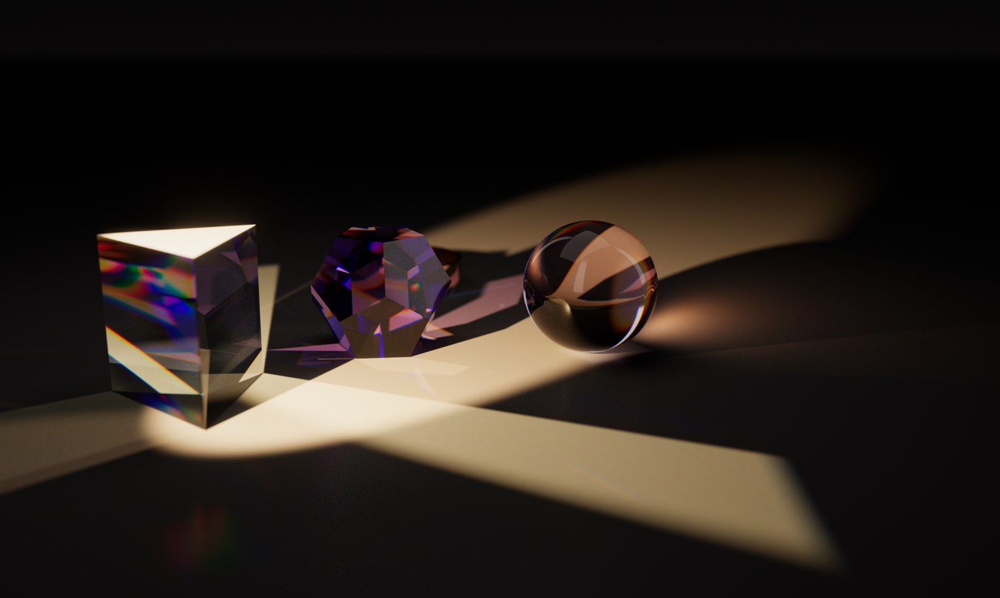
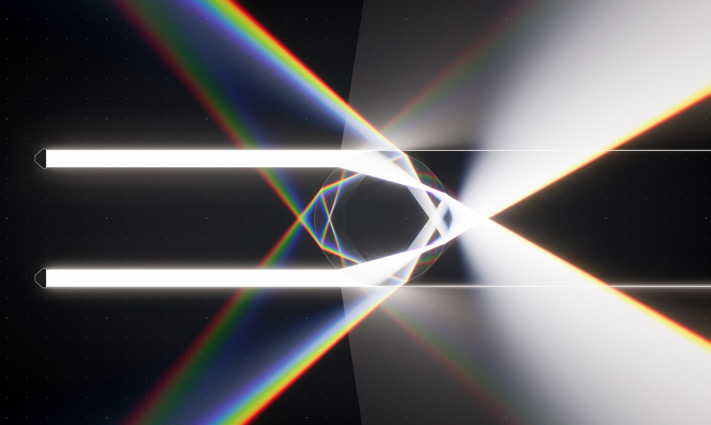

# Spectra

**A real-time light-physics playground that runs in the browser.** Spectra has two modes: a 3D spectral path tracer and a 2D optics "light table". It's a single HTML file with no libraries, no build step and no installs.

Spectra started as an experiment in what a frontier AI model can build from a detailed prompt. **Claude Fable 5.2** (Anthropic) generated most of the code from prompts I designed and refined. I tested each version, dug into the code to track down bugs, fixed some of them by hand, and directed every change.

---

## Try it

- **Online:** [seawolf0.github.io/Spectra](https://seawolf0.github.io/Spectra/)
- **Locally:** download `index.html` and open it in Safari or Chrome.

It requires a desktop browser with **WebGL2** and floating-point render targets. A recent Safari or Chrome on a Mac works well, and it was developed on an Apple Silicon MacBook Pro.

## Modes

### 3D: progressive spectral path tracer
A studio scene with a glass prism, a glass sphere, a faceted crystal and a polished metal ring, lit by a narrow beam of white light. All rendering happens in a fragment shader.

- **Spectral rendering:** paths carry real wavelengths (about 380 to 700 nm), and wavelength-dependent refraction splits white light into a rainbow (dispersion).
- **Glass and metal:** Fresnel reflection and refraction, total internal reflection, Beer–Lambert absorption for tinted glass, and spectral metal reflectance.
- **Caustics:** a GPU photon map projects focused light from the glass onto the floor.
- **Visible beams:** photon paths are drawn through a haze layer, so you can see the beam in the air.
- **Fast convergence:** next-event estimation with multiple importance sampling for the studio lights.
- **Camera:** thin-lens depth of field, with double-click to focus.
- **Color pipeline:** CIE color matching to sRGB, ACES tone mapping and bloom.
- **Progressive refinement:** the image is noisy while moving and refines toward a clean result when still. The resolution adapts to keep interaction smooth.

**Controls:** light angle, elevation, beam width and aim; color temperature, studio fill and haze; dispersion, refractive index, tint and tint density; aperture and focus distance; bounces, exposure and resolution. Click an object to select it and drag it across the floor.

**Presets:** *Pink Floyd prism*, *Caustic pool*, *Crystal cathedral*.

### 2D: spectral light table
A top-down optics bench. You build setups and watch tens of thousands of spectral rays per frame flow through them.

- **Optics:** convex and concave lenses, prisms, glass blocks, glass balls, curved glass strips, flat and curved mirrors, absorbing walls and diffuse surfaces.
- **Light sources:** white laser, flashlight, point light and a monochromatic laser with a wavelength control.
- **Editing:** move, rotate and scale with handles, plus undo/redo, duplicate, delete and arrow-key nudging.
- **Per-object glass settings:** refractive index and dispersion.

**Presets:** *Newton's prism*, *Rainbow in a raindrop* (primary and secondary bows), *Fiber optic* (total internal reflection), *Telescope* (a Keplerian refractor).

Both modes share the spectral color pipeline and the PNG screenshot button.

## Version history

| Version | What changed |
|---|---|
| **1.0** | First build: 3D path tracer and 2D light table, with three and four presets |

More versions are coming: a denoiser, more objects and presets, a guided tour and challenges, sound and an intro, and full 3D object controls.

## How it was made

1. I wrote prompts describing the goal, the physics, the interaction and the quality bar.
2. Claude Fable 5.2 (high thinking) produced the full program from each prompt.
3. I tested every version in the browser and went into the code when something broke. Some issues, like the 3D noise, went back to Fable as follow-up prompts. Others I fixed by hand.

## License

All rights reserved for now.
